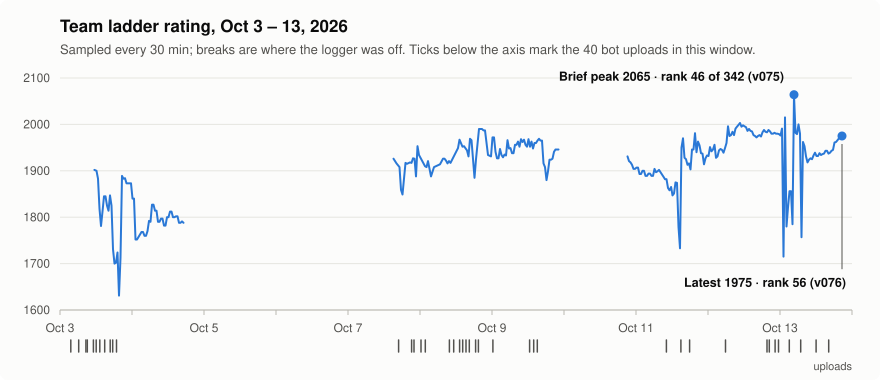
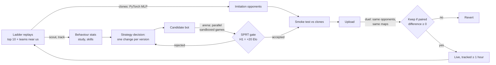

# Battlecode 2026: a C++ game AI and the pipeline that tested it

My team's bot for [UNSW Battlecode 2026](https://battlecode.au) (Sep 21 – Oct 17, 2026), plus the testing and
release pipeline we built around it. In three weeks the bot went through 80+ versions and 49 uploads to the live
ladder. From Oct 11 on, every candidate was gated by a sequential statistical test against the version before it.

## The game

Each team writes **one program**. Every unit ("dragon", a snake on a grid) runs its own copy, and the copies share
no memory. A team can have up to 64 dragons, and each takes its turn in id order. Each dragon:

- sees only the **7×7 square** around its head;
- talks to teammates only through **sonar**: a 64-bit number sent in a straight line, which stops at the first wall
  or body it hits;
- gets **100 million CPU points** (instructions, measured in a WebAssembly sandbox) per turn, and dies if it runs out;
- grows by eating pearls, can **split** in two, and can sprint (the first ceil(L/4) steps of a turn are free, the
  rest cost a segment each).

After 500 rounds the team with the longer **queen** (its lowest-id dragon) wins. A dead queen counts as length 0.
The game is mostly about keeping the queen alive and feeding her, while building an army that farms pearls and
hunts the other queen.

## Results

<picture>
  <source media="(prefers-color-scheme: dark)" srcset="docs/img/rating-dark.svg">
  
</picture>

- **Ladder:** 342 ranked teams. Over the final two days we usually sat at **rank 55–65 (rating about 1950)**, and
  peaked briefly at **2065, rank 46**.
- **Throughput:** 49 uploads (of 67 release attempts), 26 SPRT runs, 43 paired ladder
  duels, 3 automatic tuning runs, and about 52,000 local games logged.
- **Data:** we indexed about 250,000 public ladder games and parsed tens of thousands of replays to measure how the
  top teams play. One analysis alone scanned 22,903 replays.

## How it was built (who did what)

This was a team of three (team *Weneedmoretokens*), and most of the code was written by an AI coding agent
(Claude Code) working under my direction. I want to be upfront about that, because it shaped how the project ran:

- **My part:** I built the *Bá Khí* versions (Sep 27–28) together with the agent, and every later version was built
  on them. About 500 lines they added are still in the final bot (roughly 14% of it). After that: the game strategy (unit roles, which
  problems to attack next, e.g. queen safety, sprinting, and hard-coding every map), spotting problems by watching our
  replays, setting the rules the process ran by (only ship on statistical evidence, report bad numbers next to good
  ones, copy a skill only from a team measurably better at it), and making the release calls.
- **The agent's part:** turning those decisions into C++ and Python, running the experiments, and writing up the
  numbers. My running instructions to it are in [`notebook/`](notebook/), unedited.
- **Teammates:**
  - **Phuc** built the earliest versions (Sep 25–26) and fixes on top of Bá Khí (Sep 28 – Oct 1). He also built
    v004–v008 (Oct 4–6), which added the queen strike, free sprint steps, lethal-tile checks and later feeding.
  - **BoBo** built the ram-dodging rules (Sep 26) and the portal-busy warnings and Trophy aggression (Sep 30).

The most interesting engineering here is the **process**: how to decide, from noisy game results, whether a change
actually helps.

## The bot ([`bot/`](bot/), ~3,700 lines of C++20)

The queen is fixed (the lowest id). Every other dragon picks its role each turn from its length and what it sees
and hears:

| Role | Job |
|---|---|
| **Queen** | Survive near a learned "home", avoid traps, grow late from the army's feeding |
| **Workers** | Farm pearls, relay sonar, split to grow the army, feed the queen (or an endgame "giant") at the end |
| **Babies** | Short dragons that ram only favourable targets, above all the enemy queen |

Techniques, in brief (details in [docs/ARCHITECTURE.md](docs/ARCHITECTURE.md)):

- **Queen safety search:** a speed-aware danger map of where each visible enemy could reach this turn, a 2-ply
  look-ahead (can any enemy placement corner her next turn?), and a sprint search over free-step paths (exhaustive
  search up to 3 steps, beam search up to 5 for long queens).
- **Space-time targeting:** the queen plans to arrive at a pearl spawn as it appears, using the public countdowns.
- **Map knowledge, generated:** [`tools/gen_maps.py`](tools/gen_maps.py) compiles every ladder map (walls, portals,
  pearl timers, and queen "homes" learned from 2,480 winning top-team games) into `maps.hpp`. The bot recognises the
  map from its first views.
- **A sonar protocol:** messages for king election, prey sightings, enemy intel, food and queen portal warnings,
  each a 56-bit payload plus an 8-bit checksum, so noise and enemy pings are rejected.
- **Endgame "giant":** from round 150, long dragons stop splitting and small ones die beside them to feed them. This
  idea was copied from a top team's replays. It targets the tiebreak (longest dragon) that decides the game when both
  queens die, which happened in about half our games.
- **CPU discipline:** a custom protocol reader replaces the stock parser, which cost about 1.1M points a turn. The
  peak turn uses about 37M of the 100M budget.

## The pipeline ([`tools/`](tools/))



- **[`lab/sprt.py`](tools/lab/sprt.py):** a sequential probability ratio test (the method chess engines use) on
  side-swapped game pairs. It stops as soon as the evidence is clear (anywhere from 88 to 1,600 games) instead of
  playing a fixed count.
- **[`lab/spsa.py`](tools/lab/spsa.py):** SPSA tuning. It patches the bot's constants, plays ± perturbation pairs, and
  follows the noisy gradient.
- **[`lab/duel.py`](tools/lab/duel.py):** a paired comparison on the real ladder. Candidate and champion play the same
  opponents on the same maps, so opponent strength cancels out.
- **[`lab/track.py`](tools/lab/track.py):** rebuilds, from a replay's events alone, the exact input each dragon saw
  each turn. It is tested against ground truth recorded from local games. This allows **offline re-play**: feed a real
  ladder loss into a debug build and see why the bot chose that move
  ([`analysis/why_move.py`](tools/analysis/why_move.py), [`analysis/queen_offline.py`](tools/analysis/queen_offline.py)).
- **[`lab/clones.py`](tools/lab/clones.py):** an imitation bot per top team. Features come from the bot's own C++
  ([`clone/extract`](tools/clone/extract/extract.cpp)), the model is a PyTorch MLP, and the weights are exported as a
  C++ header.
- **Scheduled jobs** ([`elowatch_task.pyw`](tools/elowatch_task.pyw), [`refresh_task.pyw`](tools/refresh_task.pyw)):
  every 30 minutes, log the rating and re-scout the teams near us; every 4 hours, re-sync the rules, scrape new
  replays and retrain the clones.

Details in [docs/PIPELINE.md](docs/PIPELINE.md).

## What worked, what didn't

Most ideas failed, and the pipeline's job was to show that cheaply. A selection (full log in
[docs/RESULTS.md](docs/RESULTS.md)):

| Version | Idea | Outcome |
|---|---|---|
| v056 | Queen sprint search (top queens sprinted on 21–31% of moves, ours on 0.2%) | Shipped on a borderline SPRT (0.527 over 836 games) |
| v065 | SPSA tuning of 10 core constants | Shipped: total length +5%, overall even (0.507 over 1,628 games) |
| v075 | Endgame giant, copied from a top team | **Shipped: SPRT +, 0.524 over 1,584 games**; first ladder stretch 64% wins (35 of 55) |
| v076 | Space-time arrival + beam search | **Shipped: SPRT +, 0.528 over 1,408 games** |
| v057 | Door guards from a max-flow / min vertex cut of each map | Rejected (0.447): a guard is a farmer lost |
| v058 | Voronoi pursuit to trap the enemy queen | Rejected (0.470): chasing cost farming |
| v069 | Dijkstra navigation with danger-weighted tiles | Rejected (0.490): even in self-play and on the ladder |
| v082 | Neural-network queen trained on the moves of a team better than us at queen survival | Rejected (0.459): 80% move accuracy, but it copied their tiny-queen style and ours grew less |

Lessons I'd carry forward:

1. **Self-play can mislead.** A version that won our internal tournament lost its ladder duel by 2.7 standard
   errors. Ladder opponents hunt queens in ways our own bot doesn't, so self-play hides queen-safety problems, and
   queen-safety changes needed ladder evidence.
2. **Check the mechanism, not just the score.** One "+0.2" duel came from a change that, replayed offline, never
   altered a single cornered move. It was noise.
3. **Small losses compound.** An early rule kept versions unless they lost by 1.5 standard errors, and the rating
   slid about 235 points in a day. We switched to "keep only if the paired difference ≥ 0".
4. **Imitating the best isn't the same as being the best** (v082).

## Repository layout

```
bot/                 the final live bot (v076): main.cpp, the generated maps.hpp, a fast protocol reader;
                     helper.hpp is the competition's stock API header
tools/lab/           the pipeline: scout, track, arena, sprt, spsa, duel, release, clones, study, skills, ...
tools/analysis/      a selection of the 130+ one-off analysis scripts (queen deaths, farming, map topology, ...)
tools/clone/         the imitation-bot template and the C++ feature extractor
tools/gen_maps.py    map data -> maps.hpp
notebook/            the raw working notes and process rules, unedited (STRATEGY, WORKFLOW, GOALS)
docs/                architecture, pipeline and results write-ups
```

## Building and running

```sh
cd bot
clang++ -std=c++20 -O2 -o bot main.cpp     # the judge used Clang 20, -O2 -msimd128, compiled to WebAssembly
```

Playing games needs the competition toolkit (`pip install unswbc`): `unswbc run --sandbox` plays a match in the
judge's sandbox. The Python tools (`pip install -r requirements.txt`, run as `python -m lab.<tool>` from `tools/`)
expect a `data/` folder of scouted replays and an API key for the competition server. Neither is included, so they
are here to read rather than to run as-is.
